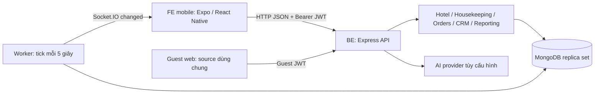
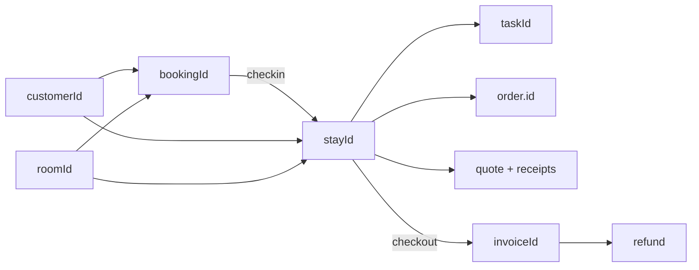

# StayFlow — bàn giao BE và FE mobile cho 2 người

Ngày đối chiếu: **31/10/2026**. Căn cứ: **source đang có trong working tree**, gồm cả thay đổi chưa commit. Đây là tài liệu để tiếp quản, hoàn thiện và ghép các phần đã có; không phải danh sách chức năng phải viết lại từ đầu. Chưa kiểm tra server hoặc APK đang cài có cùng source này hay không.

## 1. Hai người đọc theo thứ tự này

Nếu dùng Agent để thực hiện công việc, bắt đầu từ [hướng dẫn giao việc cho Agent](agents/README.md), chọn [vai trò BE](agents/BE_AGENT.md) hoặc [vai trò FE mobile](agents/FE_MOBILE_AGENT.md), rồi đọc [quy tắc API chung](agents/SHARED_API_RULES.md). Các file AGENTS.md theo thư mục đã trỏ tới bộ hướng dẫn này.

1. Cùng đọc tài liệu này, đặc biệt phần ID, luồng kết nối và tiêu chí nghiệm thu.
2. Tra từng request tại [API hiện hành](api-reference-current.md). Tài liệu có quyền, input, output, màn hình sử dụng và dữ liệu phải tải lại.
3. Import [Postman collection](stayflow-team.postman_collection.json), đặt `baseUrl`, tài khoản của môi trường test và các ID thật. Gửi từng request theo luồng nghiệp vụ; collection không tự dựng dữ liệu hay tự chạy toàn bộ workflow.
4. BE mở `backend/src/app.js`, `reads.js`, rồi service tương ứng. FE mở `frontend/src/core/api.js`, `session.jsx`, `ui.jsx`, rồi màn hình tương ứng.

Khi tài liệu cũ khác source, dùng contract đã đối chiếu trong `api-reference-current.md` và kiểm tra lại service trước khi thay đổi. Đường dẫn API phân biệt hoa/thường theo tên contract: giữ chính xác `roomTypes`, `roomType`, `serviceItem`.

## 2. Dự án giải quyết việc gì?

StayFlow quản lý nhà nghỉ: phòng → khách hàng → đặt phòng/nhận phòng → lưu trú → dịch vụ và dọn phòng → thu tiền/trả phòng → hóa đơn và báo cáo. Có web cho khách yêu cầu dọn phòng qua link riêng.

Phạm vi hiện hành:

- **Admin**: cấu hình, tài khoản, vận hành, báo cáo, hoàn tiền, xác nhận công nợ; luôn có quyền dịch vụ riêng.
- **Receptionist (Lễ tân)**: khách/phòng/đặt phòng/lưu trú, thu tiền, điều chỉnh tổng tiền có lý do, dọn phòng trực tiếp, ăn uống. Hai nhóm hỗ trợ riêng cần `canAccessSpecialServices=true`.
- **Guest**: phiên từ link, chỉ xem và thao tác trong lưu trú được cấp quyền; không phải tài khoản nhân viên.
- **Cleaner**: API, màn hình và dữ liệu cũ còn tồn tại để tương thích. Không tạo mới tài khoản Cleaner, không coi ca làm/offer là luồng mặc định mới.

Các thay đổi ngày 31/10 phải được cả hai người hiểu:

- Giao dịch mới chỉ có `HOUR` hoặc `NIGHT`; `DAY` chỉ là dữ liệu lịch sử còn đọc/tính được.
- Không bắt buộc nhập giờ trả dự kiến: BE suy ra khoảng giữ phòng. Quá giờ không tự checkout.
- Admin/Lễ tân bắt đầu và hoàn tất dọn trực tiếp, không cần ca Cleaner.
- NIGHT tính nhiều đêm và giờ lẻ theo chính sách BE; không dùng mô tả NIGHT cũ trong `business-rules.md` để viết công thức FE.
- Checkout hỗ trợ `finalTotal`, lý do điều chỉnh và thu tiền trong cùng transaction.
- Ăn uống và hai nhóm hỗ trợ riêng có danh mục, hàng đợi, lịch sử; chỉ đơn hoàn tất mới ghi phí.
- Báo cáo tài chính và CSV dành cho Admin. Dashboard của Lễ tân chỉ có số liệu vận hành.

## 3. Kiến trúc và phần mỗi người sở hữu



**Người 1 — BE** sở hữu `backend/`, schema/migration, phân quyền, dữ liệu test, transaction, tính tiền, trạng thái, worker, tích hợp AI/push và deploy API. Stack trong package: Node >=22.13, Express 5, MongoDB driver, Zod, JWT, Socket.IO. Mongo cần replica set để transaction hoạt động. Các file `.sql` là lịch sử, không dùng để nâng cấp Mongo.

**Người 2 — FE mobile** sở hữu `frontend/src/`, giao diện, navigation, form, gọi API, phiên đăng nhập, cache, xử lý lỗi, socket, thông báo và build app. Stack trong package: Expo SDK 57, React Native 0.86, React 19, JavaScript/JSX, Expo Router, React Query, Axios, React Native Paper. `frontend/jsconfig.json` đang `checkJs=false`; typecheck hiện tại không thay thế kiểm tra đầy đủ kiểu DTO.

**Cùng sở hữu** contract trong `docs/`, kịch bản ghép, dữ liệu mẫu và định nghĩa hoàn thành. `frontend/shared/policy.js` là default cho editor; BE giữ quyền quyết định giá chính thức. `frontend/app.config.js`, `frontend/eas.json`, biến URL API và lịch phát hành cần phối hợp vì app và server phải cùng contract.

Vị trí cần tra nhanh:

- HTTP/router, idempotency, lỗi: `backend/src/app.js`.
- Đăng nhập, refresh và thu hồi phiên: `backend/src/auth.js`.
- GET và quyền đọc: `backend/src/reads.js`; trường dữ liệu được ghép tại `mongo-views.js`.
- Khách, phòng, booking, stay, tiền, quản trị: `backend/src/services/hotel.js`.
- Dọn phòng: `backend/src/services/housekeeping.js`.
- Ăn uống/hỗ trợ riêng: `backend/src/services/orders.js`, `order-schema.js`.
- Sự cố/CRM: `backend/src/services/crm.js`; báo cáo: `reporting.js`; AI: `ai*.js`, `forecast.js`.
- DB và schema: `db.js`, `mongo-store.js`, `mongo-schema.js`, `backend/migrations/001_mongo.js`, `002_mongo.js` và schema snapshots.
- Wrapper HTTP: `frontend/src/core/api.js`; phiên/socket/polling: `session.jsx`; query/mutation dùng chung: `ui.jsx`.

## 4. Các ID nối API với nhau

Không dùng ID thay thế cho nhau:

- `userId`: nhân viên đăng nhập; BE xác định từ token, không lấy actor/role từ body FE.
- `roomId`: phòng vật lý. `typeId`: loại phòng/bảng giá. Phòng có `cycle` để phân biệt các lượt sử dụng khi dọn.
- `customerId`: hồ sơ khách, dùng lại qua nhiều lần ở; tra số điện thoại bằng `customer-lookup`.
- `bookingId`: phiếu đặt phòng, chưa phải lượt lưu trú. Cọc ban đầu gắn booking.
- `stayId`: lượt ở thực tế, nhận từ response `checkin`. Dịch vụ, order, task, quote, thu tiền và link khách nối vào ID này.
- `invoiceId`: hóa đơn chốt sau checkout, nhận từ response `checkout`; dùng khi hoàn tiền sau chốt.
- `receiptId`: phiếu thu; dùng `receipt-return` để hoàn trước khi chốt. Không dùng `refund` cho hoàn cọc booking.
- `serviceId`: mục danh mục. Dọn phòng tạo task bằng `serviceCode`; order dùng `serviceId`. Phí tính theo snapshot, không gửi giá do FE tự tính lên order.
- `taskId`: yêu cầu dọn phòng; khác `assignmentId` (lượt giao Cleaner) và `offerId` (lời mời Cleaner cũ).
- `order.id`: đơn ăn uống/hỗ trợ, dùng trong action cập nhật trạng thái. Đơn mới chưa phải dòng tính phí của stay.



## 5. Quy ước bắt buộc khi ghép

1. `EXPO_PUBLIC_API_URL` là origin, ví dụ `http://192.168.1.20:4000`, **không có `/api` ở cuối**; wrapper tự nối `/api`. Postman `baseUrl` cũng là origin. Socket nối origin, không nối `/api`.
2. JSON dùng ID UUID, tiền VND nguyên, ngày giờ ISO có múi giờ. Ví dụ `2026-11-01T14:00:00+07:00`; output Date serialize thành UTC. FE hiển thị giờ Việt Nam, không gửi chuỗi `01/11/2026 14:00` lên API.
3. GET danh sách trả **mảng trực tiếp**, không phải `{data,total,page}`. Các danh sách có phân trang nhận `page` từ 1, cố định 30 dòng; không có `total`/`hasNext`. Không mặc định mọi resource đều phân trang hoặc đều hỗ trợ `search`.
4. Mọi `POST /api/actions/<name>` cần `Authorization`, `Content-Type: application/json`, `Idempotency-Key` dài 8–100 ký tự. Login/refresh/exchange/AI không dùng cơ chế action này.
5. Một ý định ghi dùng một key. Mạng timeout: giữ nguyên action/body/key để thử lại; dữ liệu đổi hoặc ý định mới: tạo key mới. Cùng key nhưng action/body khác trả 409. Key được scope theo actor, **không riêng theo endpoint**. Tránh đổi thứ tự trường JSON khi phát lại vì BE hash `JSON.stringify`.
6. `useAction()` hiện giữ key theo action/body trong bộ nhớ hook, xóa sau thành công và invalidate tất cả queries. Key chưa được lưu bền qua unmount/restart; FE cần tải trạng thái từ BE trước khi tạo thao tác mới sau khi mất phiên/màn hình. Gọi `action()` trực tiếp không truyền key sẽ tạo key mới mỗi lần.
7. FE không PATCH trạng thái tùy ý, không tự tính giá chính thức, không suy đoán đơn đã hoàn tất chỉ vì nhận socket. Sau mutation đọc lại resource. API là nguồn trạng thái cuối cùng.
8. `401`: xóa phiên/cache và đăng nhập lại theo hành vi hiện tại; `403`: thông báo thiếu quyền; `400`: hiện lỗi trường; `409`: đọc lại dữ liệu rồi cho sửa/thử lại với ý định phù hợp; `429`: chờ theo header/thông báo; lỗi mạng/5xx: giữ form và kiểm tra kết quả trước retry ghi.
9. Lỗi nghiệp vụ thường là `{error,fields?}`. Rate limiter chung/AI có thể trả text mặc định; không giả định mọi response lỗi đều là JSON có `fields`.
10. Quyền phải kiểm tra lại ở BE. UI ẩn mục riêng chỉ hỗ trợ trải nghiệm; thay token hoặc gọi URL trực tiếp vẫn phải bị chặn. Khi Admin sửa quyền/tài khoản, `authVersion` tăng, phiên cũ có thể nhận 401.

Phiên hiện tại: staff access JWT 8 giờ, refresh token 7 ngày và quay vòng khi dùng. FE refresh khi khôi phục app từ SecureStore; gặp 401 trong request hiện **đăng xuất**, chưa có tự refresh rồi replay request. Guest JWT 2 giờ, không có refresh; cấp link mới hoặc checkout làm quyền cũ hết hiệu lực.

## 6. Các luồng hai người phải ghép cùng nhau

### A. Đăng nhập → tổng quan

1. FE `POST /auth/login {username,password}` → lưu `user`, `token`, `refreshToken`, đặt Bearer.
2. FE GET `/me`, `/dashboard`, `/notifications`; Admin có thêm trường tài chính/report, Lễ tân không có.
3. FE nối Socket.IO với `auth:{token}`. Event `changed` → invalidate/refetch. Polling 15 giây và refetch khi app foreground/connect là phương án đồng bộ đang có.
4. BE thay quyền/khóa user → phiên cũ bị từ chối; FE xóa cache để không giữ dữ liệu của phiên trước.

Nghiệm thu: Admin và Lễ tân nhìn đúng dữ liệu; logout/login người khác không lẫn cache; token hết hạn không làm app crash.

### B. Tra khách → phòng trống → booking/cọc → check-in

1. GET `/customer-lookup?phone=...` → `Customer` hoặc `null`. FE debounce và bỏ kết quả của số cũ. Không thấy khách thì gửi `customer:{name,phone,notes?}` ngay trong booking/checkin; BE resolve khách trong transaction.
2. GET `/availability?start=<ISO>&mode=HOUR|NIGHT` (hoặc thêm `end` rõ ràng). Khi sửa booking, truyền `excludeBooking`.
3. POST action `booking` → `{id:bookingId}`; cọc tùy chọn tạo receipt ngay. Đọc lại `/bookings`, `/booking-receipts?bookingId=...`, `/availability`.
4. POST action `checkin {bookingId}` → `{id:stayId}`. Dữ liệu room/customer/mode đã đặt lấy từ DB. Nhận trực tiếp dùng `roomId`, `customerId` hoặc `customer`, `guests`, `mode`.
5. BE chuyển booking sang CHECKED_IN, tạo stay OPEN, snapshot giá và chuyển cọc vào stay. FE tải lại `/rooms`, `/stays`, `/quote?stayId=...`, `/receipts?stayId=...`.

Nghiệm thu: hai thiết bị cùng nhận một phòng chỉ một yêu cầu thành công; số +84/0084 và 0 dùng lại đúng hồ sơ; check-in dùng đúng `stayId` mới, không tiếp tục dùng `bookingId`.

### C. Dịch vụ/ăn uống/hỗ trợ riêng → tiền lưu trú

1. Dịch vụ thường: GET `/services` → action `serviceItem {stayId,serviceId,quantity,itemId?}` → đọc lại quote.
2. Ăn uống: GET `/food-items` → `food-order {stayId,items:[{serviceId,quantity,notes?}],notes?}` → `{id,status:PENDING,total}`.
3. Action `food-order-status {id,status:PREPARING}` rồi `COMPLETED` → BE thêm dòng phí đúng một lần. Hủy PENDING/PREPARING dùng `CANCELLED`, không ghi phí.
4. Hỗ trợ riêng: GET `/special-services?purpose=MEAL_ASSISTANCE|PRIVATE_SUPPORT`, GET `/special-requests?purpose=...`; action `special-request` cần `purpose` trong body. Hai nhóm có danh mục/hàng đợi tách nhau; luôn truyền purpose khi GET vì mặc định là MEAL_ASSISTANCE.
5. Quyền riêng do BE kiểm tra từ Users. Người không có quyền không nhận tên/ID đơn riêng qua quote; chỉ thấy dòng tổng quát “Dịch vụ riêng”.

Nghiệm thu: tạo đơn chưa làm quote tăng; hoàn tất mới tăng; retry không nhân đôi; không chuyển COMPLETED về trạng thái trước; đơn chờ chặn checkout.

### D. Dọn phòng trực tiếp và mở lại phòng sau checkout

1. Tạo yêu cầu `task-create` cho stay OPEN: chọn FULL/LINEN/BATHROOM/TOWELS, khung giờ, xác nhận vào phòng và đồng ý phí nếu có.
2. GET `/tasks` → lấy `id`, `status`, `checklistJson`, `cycle`, thông tin phòng/dịch vụ. FE `JSON.parse(checklistJson)` để hiện checklist do BE trả; không tự hardcode checklist khác.
3. `task-desk-start {taskId,reason?}` → IN_PROGRESS. Không cần ca Cleaner; nếu tiếp nhận việc đã giao cần lý do ít nhất 5 ký tự.
4. `task-desk-complete {taskId,checklist:[đầy đủ chuỗi từ BE]}` → BE kiểm tra và verify trong cùng transaction → COMPLETED; phí nếu có ghi một lần. FE tải lại tasks/rooms/quote.
5. Sau checkout, BE tạo TURNOVER nội bộ. Phòng vẫn bẩn cho đến khi hoàn tất việc dọn full của đúng cycle; turnover không do FE tự tạo bằng task-create.

Nghiệm thu: DND/chưa consent/ngoài khung giờ/cycle cũ bị chặn; thiếu checklist không hoàn tất; dọn trực tiếp hoạt động với Lễ tân không có ca. Luồng Cleaner cũ vẫn là ASSIGNED → IN_PROGRESS → AWAITING_VERIFICATION → COMPLETED nếu cần đọc dữ liệu lịch sử.

### E. Quote → thu tiền/điều chỉnh → checkout → hóa đơn

1. GET `/quote?stayId=...` → `room`, `items`, `services`, `total`, `paid`, `refunded`, `adjustments`, `balance`, `credit`, `invoice`.
2. Thu trước: `receipt {stayId,amount,method}`. Cọc chưa check-in dùng `bookingId`; chọn một trong hai, không gửi cả hai.
3. Trả phòng thu đủ: `checkout {stayId,payRemaining:true,paymentMethod:CASH|TRANSFER}`. BE tính tại thời điểm checkout và thu phần còn lại cùng transaction.
4. Điều chỉnh: thêm `finalTotal`, `adjustmentReason` ít nhất 5 ký tự. Lễ tân được điều chỉnh; không đồng thời gửi finalTotal và discount/surcharge khác 0.
5. Admin cho nợ: `allowDebt:true`, `reason` ít nhất 5 ký tự, `paymentAmount` là khoản thực thu; không chọn `payRemaining:true` nếu muốn giữ phần nợ.
6. Tiền cọc/thu vượt tổng cuối: Admin `receipt-return {receiptId,amount,reason}` trước khi chốt. Sau có invoice dùng `refund {invoiceId,amount,reason}`; BE hoàn tiền và giảm nghĩa vụ cùng transaction.
7. Checkout → `{id:invoiceId,total}`; stay CLOSED, booking/link/task liên quan được xử lý ở BE, phòng cần dọn TURNOVER. FE tải lại rooms/stays/invoices/quote/receipts/tasks/dashboard.

Nghiệm thu: đơn PENDING/PREPARING hoặc task đang làm/chờ kiểm tra chặn checkout; không tự lấy quote cũ làm tổng cuối; retry checkout không tạo hai hóa đơn/phiếu thu; snapshot và lý do điều chỉnh xem được trên hóa đơn.

### F. Link khách → DND/yêu cầu dọn phòng

1. Staff `guest-link {stayId}` → `{url}` có `#token=...`. Đây là token link ngẫu nhiên, không phải JWT để đặt trực tiếp vào Bearer.
2. Guest mở route `frontend/src/app/guest.jsx`, `POST /guest-access/exchange {token}` → guest JWT, `stayId`, `room`.
3. Guest dùng Bearer riêng để GET `/guest-stay`, `/tasks`, `/services`; ghi `dnd`, `task-create`, `task-cancel`, `task-review` trong phạm vi stay của mình.
4. Cấp link mới/checkout vô hiệu quyền cũ. Guest không nối socket staff; vẫn dùng cơ chế query/polling.

Nghiệm thu: guest không xem stay người khác hoặc dùng resource phòng/khách/hóa đơn của nhân viên; token link không xuất hiện trong tài liệu/chia sẻ log dự án.

### G. Báo cáo và AI

- Admin GET `/dashboard?from=<ISO>&to=<ISO>` và `/reports.csv` cùng khoảng `[from,to)`. Lễ tân GET dashboard không khoảng chỉ để vận hành.
- Doanh thu theo hóa đơn chốt trong kỳ; thực thu theo thời điểm thu/hoàn; công nợ là nghĩa vụ còn lại tại lúc xem của hóa đơn trong kỳ. Không cộng PaymentAllocations vào số thực thu.
- `/ai/draft` chỉ gợi ý form dọn phòng; cần người xác nhận rồi gọi task-create. `/ai/manager` chỉ đọc allowlist. `/ai/marketing` chỉ tạo bản nháp.
- AI key/provider ở BE. Form thường phải dùng được khi AI thiếu key/quota/lỗi. `/forecast` là mô hình thống kê, có thể trả `available:false` khi chưa đủ 56 ngày dữ liệu.

## 7. Chia backlog cụ thể cho 2 người

Đây là thứ tự tiếp quản/hoàn thiện đề xuất; đánh dấu phần đã đạt sau khi hai người chạy cùng môi trường. Mỗi mốc phải có một luồng chạy xuyên suốt trước khi chuyển mốc.

### M0 — Môi trường và contract chung

- BE: chạy Mongo replica set, migrate 001/002, seed **môi trường demo mới**, chuẩn bị Admin/Lễ tân có và không có quyền riêng, 2 phòng và danh mục đủ để thử; bàn giao origin API và `/health`.
- FE: cấu hình API LAN/test, chạy app, kiểm tra `/health` từ thiết bị, dựng form/login và trạng thái lỗi có sẵn; xác nhận wrapper không nối `/api` hai lần.
- Cả hai: ghi baseUrl/version source/migration vào ghi chú môi trường test; thử Postman login rồi login trên mobile.

### M1 — Phiên và quyền

- BE: xác nhận login/refresh/me/logout/password, thu hồi phiên khi sửa user, phân quyền từ DB.
- FE: SecureStore, khôi phục phiên, 401, role menu, ẩn mục riêng, clear cache, socket reconnect.
- Bàn giao: một request thành công và một 401/403 đúng contract; không nhầm refresh tự động hiện chưa có.

### M2 — Khách, phòng và booking

- BE: customer lookup/normalize/upsert trong booking, availability, booking/cọc, cancel và kiểm tra xung đột.
- FE: `CustomerPicker`, `Customers`, `Rooms`, `Bookings`; debounce, chọn phòng, form HOUR/NIGHT, cọc và lịch sử.
- Bàn giao: tra lại khách cùng SĐT, đặt/thu cọc và tình huống hai yêu cầu cùng phòng.

### M3 — Check-in và lưu trú

- BE: checkin trực tiếp/từ booking, giá snapshot, receipts/quote, serviceItem, guest-link.
- FE: `Stays`, chi tiết, dịch vụ, thu tiền, link khách và nhận đúng stayId.
- Bàn giao: đặt → nhận → cọc xuất hiện đúng trong quote; nhận trực tiếp với khách mới trong một transaction.

### M4 — Dọn phòng

- BE: task-create/desk-start/desk-complete, consent/DND/cycle/checklist/phí một lần, TURNOVER; bảo toàn luồng cũ.
- FE: `Housekeeping`, `TaskForm`, guest route, checklist từ BE, lý do tiếp nhận; không phụ thuộc Cleaner shift trong giao diện mới.
- Bàn giao: dọn trong stay và dọn TURNOVER mở lại phòng READY; thử DND và thiếu checklist.

### M5 — Ăn uống và hỗ trợ riêng

- BE: catalogue, order status, snapshot giá, giới hạn quyền riêng, ghi phí khi hoàn tất, chặn checkout khi còn đơn.
- FE: `Orders` với FOOD và hai purpose SPECIAL; filter, giỏ/số lượng/notes, trạng thái, admin catalogue và menu theo quyền.
- Bàn giao: ba nhóm tách đúng; Lễ tân không có quyền không đọc được API riêng, quote không lộ nội dung riêng.

### M6 — Checkout, hóa đơn và báo cáo

- BE: thu cùng checkout, finalTotal/lý do, công nợ Admin, receipt-return/refund, invoice lines, báo cáo/CSV.
- FE: `Stays`, `Invoices`, `Dashboard`, xuất/chia sẻ file; hiện số gốc/số cuối/điều chỉnh; xử lý conflict và retry.
- Bàn giao: đủ tiền, có nợ, cọc dư, retry timeout và đối soát tiền trước/sau hoàn.

### M7 — Hoàn thiện và phát hành

- BE: maintenance/incidents, quản trị/CRM, notification/outbox/AI fallback; chạy unit + integration, backup/migrate/deploy đúng môi trường.
- FE: Admin/Marketing/Incidents/Profile/Notifications/Assistant, loading/error/empty và phân trang; lint/typecheck, export/build và test thiết bị thật.
- Cả hai: chạy lại toàn bộ kịch bản xuyên suốt, chốt API/version, cập nhật tài liệu, sau đó mới đồng bộ server và APK.

Nếu chỉ đủ thời gian MVP: ưu tiên M0–M6; AI, CRM nâng cao, push từ xa và mở rộng Cleaner để sau, tùy yêu cầu nghiệm thu. In-app notification/socket/polling vẫn cần hoạt động để vận hành.

## 8. Cách làm song song để không chờ nhau

1. Trước mỗi module, BE đưa request mẫu, output mẫu và hai lỗi thường gặp; FE xác nhận tên trường, enum và cách hiển thị.
2. FE có thể làm form theo DTO mẫu trong tài liệu; chỉ gọi endpoint thật khi BE có dữ liệu test. Không sửa FE để âm thầm chấp nhận trường tùy đoán.
3. BE đổi contract phải cập nhật tài liệu/collection và báo rõ field thêm/xóa, quyền và migration. FE cập nhật parse/form/cache trong cùng mốc ghép.
4. Mỗi ticket ghi: màn hình, API, người sở hữu, phụ thuộc, dữ liệu mẫu, response mong đợi, lỗi 400/403/409 và tiêu chí hoàn thành.
5. Dùng nhánh riêng theo trách nhiệm/module. Cây nguồn hiện có nhiều thay đổi chưa commit: chốt baseline chung trước khi hai người tách nhánh; không reset/xóa các thay đổi đang có.
6. Ghép sớm theo luồng trên cùng DB test. “Postman gọi được” và “màn hình render được” riêng lẻ chưa đủ để đóng ticket.

Mẫu ticket: **M5 — Hoàn tất đơn ăn uống ghi phí đúng một lần**. BE: food-order-status + transaction/index. FE: nút cập nhật + chặn double tap + refetch quote. Phụ thuộc: M3 stay OPEN, catalogue FOOD. Done: PENDING/PREPARING không có phí, COMPLETED có phí, retry cùng key vẫn một phí, checkout không bị chặn sau khi đơn kết thúc.

## 9. Kiểm thử và tình trạng xác minh

Đầu việc cần chốt trước khi đóng M4: Guest UI hiện cho đánh giá mọi task COMPLETED, nhưng `task-review` trong `housekeeping.js` truy cập `last.cleanerId` từ assignment SUBMITTED mà chưa kiểm tra trường hợp không có assignment. Task dọn trực tiếp có thể rơi vào trường hợp này. Đây là nhận xét từ source, chưa tái hiện runtime trong lượt tổng hợp. BE cần thống nhất hỗ trợ đánh giá dọn trực tiếp hoặc trả trạng thái không hỗ trợ rõ ràng; FE cập nhật điều kiện hiện nút tương ứng. Chưa coi luồng Guest review dọn trực tiếp đã hoàn chỉnh.

Từ gốc repository `D:\Ky7\mma-project\mma-project`:

```powershell
npm run lint
npm run typecheck
npm test
npm run test:integration:local
npm run test:ui
```

- `npm test`: unit/HTTP tests không thay thế Mongo integration.
- `test:integration:local`: runner mongod local replica set; tạo DB test riêng, cần MongoDB executable theo hướng dẫn trong `bugfix-verification.md`.
- `test:ui`: Expo Web/Chrome headless, cần runtime Playwright/Chrome; không thay thế Android thật.
- Hai người phải kiểm thử thêm trên điện thoại: URL LAN/HTTPS, reconnect, background/foreground, expired session, double tap và timeout lúc checkout.

Checkpoint đã ghi trong [bugfix-verification.md](bugfix-verification.md): 27/27 unit/HTTP, 40/40 integration MongoDB native 8.2.6 và 5 luồng web trên viewport mobile; đó là **kết quả phiên trước**, không phải xác nhận lại toàn bộ trong lượt tổng hợp này. Chưa coi Android thật, remote push hoặc Mongo production Docker 8.0 đã được xác minh chỉ từ các kết quả đó.

Lượt tổng hợp này chỉ thêm tài liệu/collection và liên kết; kết quả kiểm tra hiện tại được ghi tại [handoff-verification.md](handoff-verification.md). Không triển khai server, không build APK, không gọi provider AI hoặc API production.

## 10. Thiết lập môi trường và giới hạn cần nhớ

- Đọc README để cài dependency và Docker; chạy lệnh backend từ `backend/`. Dùng `backend/.env.example` và `frontend/.env.example` làm mẫu tương ứng cho môi trường mới, không sao chép secret vào tài liệu.
- API local mặc định port 4000; Mongo demo trong compose dùng port 27027 và replica set rs0. Điện thoại dùng IP LAN của máy chạy BE, không dùng localhost của máy tính.
- `JWT_SECRET`, `MONGO_URI`, `MONGO_DATABASE`, `CORS_ORIGINS`, `GUEST_WEB_URL`, cấu hình AI/push do BE quản lý. FE chỉ nhận public origin API; không đóng gói DB credential hay AI key.
- Migration 002 bổ sung order/quyền/metadata. Server hiện có dữ liệu dùng quy trình backup/migrate trong `update-server-20261031.md`; không seed/reset để nâng cấp.
- README/API cũ có thông tin lịch sử về Cleaner/DAY/quyền CSV. Contract hiện hành trong tài liệu kèm được đối chiếu source local, không suy ra rằng server từ xa đã được cập nhật.
